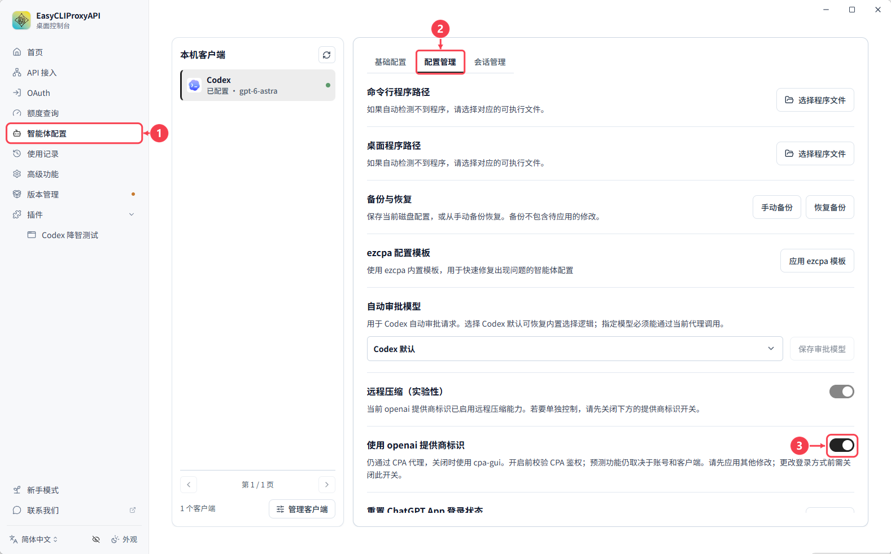

# CodexGate

[简体中文](README.zh-CN.md) · [Releases](https://github.com/chatwithgod/cpa-plugin-codexgate/releases) · [Development Docs](docs/DEVELOPMENT.md)

**Fixes the missing dot entry in Codex after connecting to CPA.**

CodexGate is a CPA (CLIProxyAPI) plugin designed to resolve the issue where the **dot entry disappears** when custom provider identifiers are used, working in tandem with ECPA's **"Use openai provider identifier" (使用 openai 提供商标识)** feature.

If you only enable this toggle, the dot entry may reappear, but requests may fail: Codex authenticates using your local ChatGPT login, whereas CPA normally expects an API Key. CodexGate bridges this gap by enabling CPA to recognize the currently valid local Codex login.

Model requests still route through CPA, and your existing API Keys remain active. **No need to copy login tokens, no need to configure model lists, and no extra background programs to run.**

## Prerequisites

- CPA and Codex run on the same computer under the same system user.
- Codex is already logged in with a ChatGPT account and has a local `auth.json` credential file saved.

The plugin automatically detects the login file, so manual configuration is usually not required. Currently, file-based credentials are supported; system credential vaults are not. For containers or remote deployments, see the [development documentation](docs/DEVELOPMENT.md#login-file-and-deployment).

## Download Plugin

CodexGate is not yet listed in the plugin store. Please download the stable release from [Releases (v0.1.1)](https://github.com/chatwithgod/cpa-plugin-codexgate/releases/tag/v0.1.1).

Select the package matching your operating system:

| OS / Architecture | Package |
|---|---|
| Windows 64-bit | `codexgate_0.1.1_windows_amd64.zip` |
| Linux x86_64 | `codexgate_0.1.1_linux_amd64.zip` |
| Linux ARM64 | `codexgate_0.1.1_linux_arm64.zip` |
| macOS Intel | `codexgate_0.1.1_darwin_amd64.zip` |
| macOS Apple Silicon | `codexgate_0.1.1_darwin_arm64.zip` |

## Installation and Activation

Keep this order in mind:

**Install and enable the plugin first → Turn on "Use openai provider identifier" → Restart Codex.**

### 1. Place the Plugin File

Wait until your current tasks finish, then stop CPA.

Extract the downloaded ZIP package and place the plugin file into the CPA plugins directory (typically named `plugins`). The target paths are shown below; you can create any missing subdirectories manually:

| OS / Architecture | Target File Path inside `plugins` |
|---|---|
| Windows 64-bit | `windows/amd64/codexgate.dll` |
| Linux x86_64 | `linux/amd64/codexgate.so` |
| Linux ARM64 | `linux/arm64/codexgate.so` |
| macOS Intel | `darwin/amd64/codexgate.dylib` |
| macOS Apple Silicon | `darwin/arm64/codexgate.dylib` |

### 2. Enable CodexGate

Start CPA, find **CodexGate** in the plugin management page, and enable it.

Keep your existing API Keys as they are; there is no need to delete or replace them.

### 3. Enable Settings in ECPA

Make sure CodexGate is enabled, then follow the numbered steps in the interface:

1. Click **智能体配置** (Agent Configuration) in the left sidebar, and select **Codex**.
2. Switch to the **配置管理** (Configuration Management) tab at the top.
3. Turn on the **使用 openai 提供商标识** (Use openai provider identifier) toggle.

### 4. Restart Codex

Completely exit and relaunch the Codex desktop client, then verify:

- The dot entry appears and responds normally.
- New chat sessions send and receive responses properly.
- Requests show up as expected in the CPA usage logs.

## Not Using ECPA?

You can also use standalone CPA without ECPA. In this case, you need to manually edit **Codex's configuration file** to configure the provider identifier and the CPA endpoint URL.

For step-by-step instructions, see the [Manual Codex Configuration](docs/DEVELOPMENT.md#manual-codex-configuration) guide. Users who enable the ECPA toggle do not need to make this manual change.

## Disabling and Uninstallation

To revert your setup, follow these steps:

1. Turn off "使用 openai 提供商标识" (Use openai provider identifier) in ECPA, or restore your previous Codex provider settings.
2. Restart Codex.
3. Disable CodexGate in CPA's plugin management interface.

If you want to remove the plugin files completely, stop CPA first, and then delete the **CodexGate plugin files**. Your existing API Keys remain unaffected.

## Documentation and License

- [Development and Configuration Guide](docs/DEVELOPMENT.md)
- [Verification Records](docs/VERIFICATION.md)
- [Third-Party Notices and Licenses](THIRD_PARTY_NOTICES.md)

This project is licensed under the [MIT License](LICENSE).
